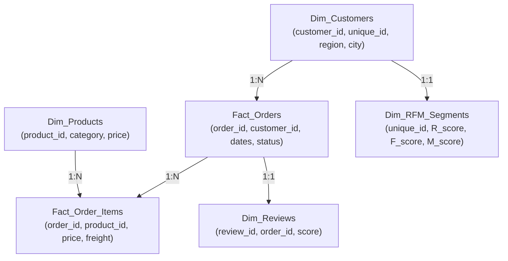
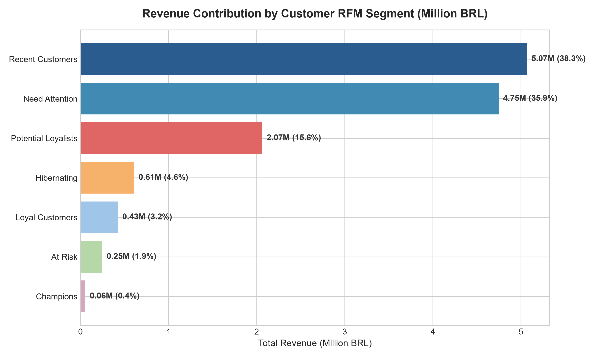
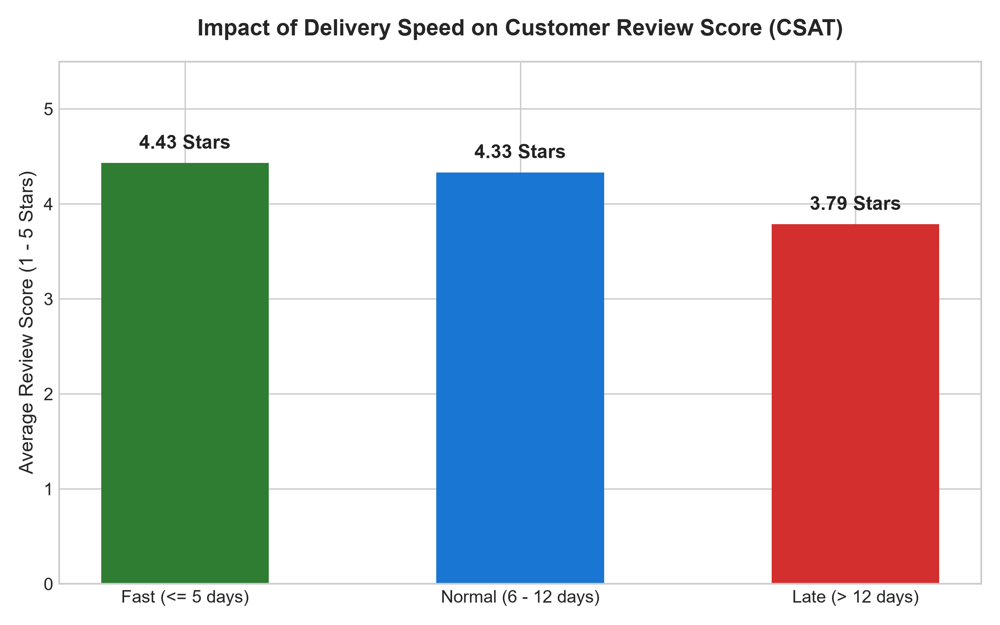
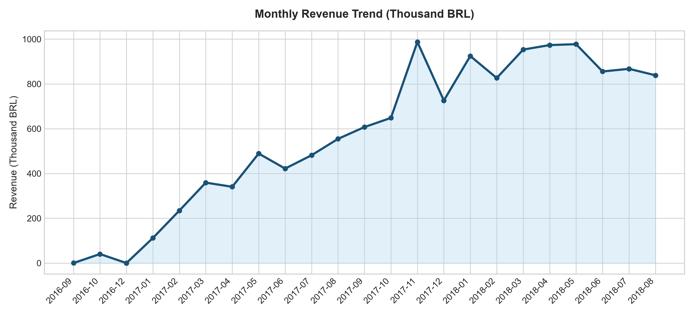

# 🛒 E-Commerce Customer Retention & RFM Segmentation Analysis
### *End-to-End Business Intelligence & Customer Analytics on 100k+ Olist Transactions*

<p align="center">
  
  
  
  
  
</p>

---

## 📌 Executive Summary

This project delivers an end-to-end data analytics solution evaluating customer lifetime behavior, delivery performance, and revenue distribution across **100,000+ real-world commercial transactions** from **Olist** (Brazil's leading e-commerce marketplace).

### 🎯 Key Performance Indicators (KPIs)
| Metric | Value | Business Context |
| :--- | :--- | :--- |
| **Gross Merchandise Value (GMV)** | **13,221,498 BRL** | Total delivered product sales |
| **Delivered Orders** | **96,478 orders** | 97.02% successful fulfillment rate |
| **Unique Customer Base** | **93,358 buyers** | Distinct consumer footprint across Brazil |
| **Average Order Value (AOV)** | **137.04 BRL** | Baseline basket size |
| **Repeat Purchase Rate** | **~3.0%** | Marketplace retention challenge |

---

## 🏢 Business Problem & Objectives

1. **High Churn / Low Retention Risk:** Over 96.9% of customers only transact once. Customer Acquisition Cost (CAC) is unsustainable without an automated retention strategy.
2. **Customer Value Heterogeneity:** The business lacked a quantitative framework to distinguish high-value clients from dormant accounts.
3. **Logistics Bottleneck vs. CSAT:** Unclear correlation between fulfillment speed and customer review ratings (1–5 stars).

---

## 🏗️ Data Architecture & Star Schema



---

## 📊 Visual Insights & Dashboard Highlights

### 1. Revenue Contribution by RFM Customer Segment
High-value segments (*Champions* and *Loyal Customers*) spend up to **3.6x more** per order than typical one-time buyers.

<p align="center">
  
</p>

### 2. Operational Impact: Delivery Speed vs. CSAT Rating
A steep drop in satisfaction occurs when deliveries exceed 12 days: negative reviews (1–2 stars) surge to **21.0%**.

<p align="center">
  
</p>

### 3. Monthly Revenue Trajectory
Marketplace sales expanded steadily, demonstrating scalable volume across Brazilian states.

<p align="center">
  
</p>

---

## ⚙️ Technical Implementation

### 1. SQL RFM Segmentation Logic
```sql
WITH reference_date AS (
    SELECT MAX(CAST(order_purchase_timestamp AS TIMESTAMP)) + INTERVAL '1 day' AS max_date
    FROM orders
    WHERE order_status = 'delivered'
),
raw_rfm AS (
    SELECT 
        c.customer_unique_id,
        DATEDIFF('day', MAX(CAST(o.order_purchase_timestamp AS TIMESTAMP)), ref.max_date) AS recency_days,
        COUNT(DISTINCT o.order_id) AS frequency,
        ROUND(SUM(oi.price), 2) AS monetary
    FROM orders o
    JOIN customers c ON o.customer_id = c.customer_id
    JOIN order_items oi ON o.order_id = oi.order_id
    CROSS JOIN reference_date ref
    WHERE o.order_status = 'delivered'
    GROUP BY c.customer_unique_id, ref.max_date
),
rfm_scores AS (
    SELECT 
        customer_unique_id,
        recency_days,
        frequency,
        monetary,
        NTILE(5) OVER (ORDER BY recency_days DESC) AS r_score,
        CASE 
            WHEN frequency >= 4 THEN 5
            WHEN frequency = 3 THEN 4
            WHEN frequency = 2 THEN 3
            ELSE 1
        END AS f_score,
        NTILE(5) OVER (ORDER BY monetary ASC) AS m_score
    FROM raw_rfm
)
SELECT 
    customer_unique_id,
    r_score,
    f_score,
    m_score,
    CASE 
        WHEN r_score >= 4 AND f_score >= 4 AND m_score >= 4 THEN 'Champions'
        WHEN r_score >= 3 AND f_score >= 3 THEN 'Loyal Customers'
        WHEN r_score >= 4 AND f_score = 1 THEN 'Recent Customers'
        WHEN r_score >= 3 AND f_score <= 2 AND m_score >= 3 THEN 'Potential Loyalists'
        WHEN r_score <= 2 AND f_score >= 3 THEN 'At Risk'
        WHEN r_score <= 2 AND f_score <= 2 AND m_score <= 2 THEN 'Hibernating'
        ELSE 'Need Attention'
    END AS customer_segment
FROM rfm_scores;
```

### 2. Core DAX Formulations (Power BI)
```dax
Total Revenue = SUM(order_items[price])
```

```dax
Average Order Value = DIVIDE([Total Revenue], [Total Delivered Orders], 0)
```

```dax
Late Delivery Rate % = 
VAR TotalDelivered = CALCULATE(COUNTROWS(orders), orders[order_status] = "delivered")
VAR LateOrders = 
    CALCULATE(
        COUNTROWS(orders),
        orders[order_status] = "delivered",
        orders[order_delivered_customer_date] > orders[order_estimated_delivery_date]
    )
RETURN
DIVIDE(LateOrders, TotalDelivered, 0)
```

---

## 📈 Strategic Recommendations & ROI

| Initiative | Target Segment | Execution Mechanism | Expected Business Impact |
| :--- | :--- | :--- | :--- |
| **"Second Purchase" Automation** | Recent Customers | Automated email sequence 14 days post-delivery offering 10% next-order voucher | Elevate repeat purchase rate from 3.0% to 5.5% (+350k BRL GMV) |
| **VIP Retention Tier** | Champions & Loyal | Free shipping threshold discounts and dedicated priority CS | Preserve high-LTV segment against competitor acquisition |
| **Logistics SLA Re-routing** | Remote States (North/Northeast) | Shift fulfillment to local regional fulfillment centers (Hubs) | Reduce late fulfillment from 35% to <10%, boosting CSAT to 4.4 |

---

## 📁 Repository Structure

```
.
├── data/
│   ├── raw/                       # Cleaned source tables (Customers, Orders, Items, Reviews, Products)
│   ├── processed/                 # Segmented RFM customer records (CSV)
│   └── ecommerce.db               # Pre-indexed SQLite database
├── sql/
│   ├── 01_data_cleaning.sql       # Cleaning views and fulfillment validation
│   ├── 02_rfm_segmentation.sql    # RFM Scoring & classification queries
│   ├── 03_cohort_retention.sql    # Monthly cohort retention matrix
│   └── run_queries_sqlite.py      # Automated terminal execution script
├── powerbi/
│   ├── dashboard_mockup/          # High-resolution portfolio visual charts
│   └── docs/powerbi_dashboard_design.md # Star Schema data model & DAX guide
├── python/
│   ├── 01_eda_and_rfm_analysis.ipynb # Interactive analysis notebook
│   ├── download_real_data.py      # Automated scraper from Olist GitHub repo
│   ├── clean_and_transform_data.py# Category translation and ETL pipeline
│   ├── eda_and_rfm.py             # RFM calculation and customer tiering engine
│   └── create_dashboard_charts.py # Portfolio visualization rendering script
├── docs/
│   ├── business_insights.md       # Executive business report & STAR interview guide
│   └── powerbi_dashboard_design.md# Power BI architecture specifications
└── README.md
```

---

## 🚀 How to Reproduce

### Run Database Queries Locally
```bash
python sql/run_queries_sqlite.py
```

### Run Jupyter Notebook
```bash
jupyter notebook python/01_eda_and_rfm_analysis.ipynb
```

---

## 👤 Author
* **GitHub:** [@ngphong01](https://github.com/ngphong01)  
* **Role:** Data Analyst / Business Intelligence Specialist  
* **Domain Focus:** E-Commerce, Retail Analytics, Customer Retention
